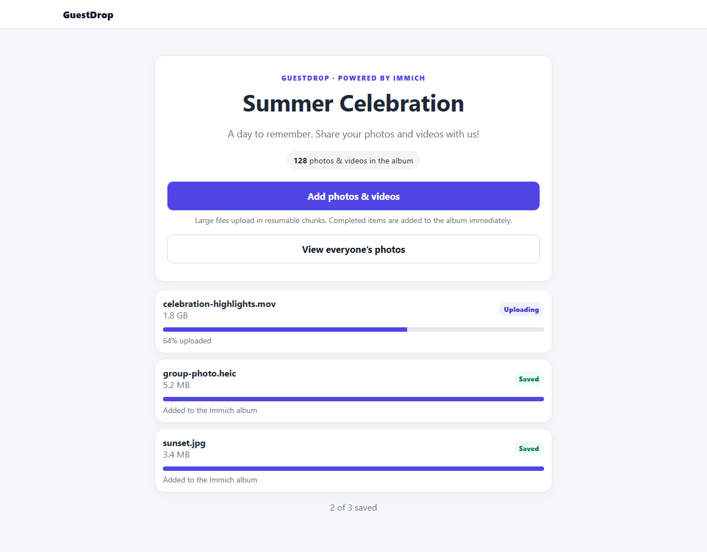
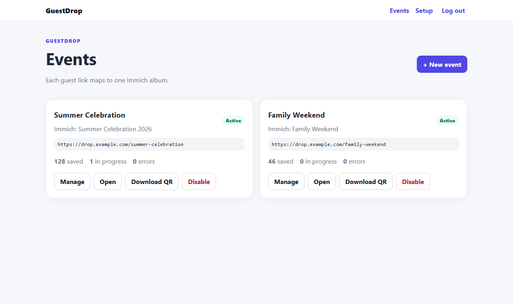

# GuestDrop

**Large guest uploads. Small resumable chunks. Straight into your Immich album.**

GuestDrop is a self-hosted companion for Immich that lets guests share photos and large videos through a simple link or QR code. Guests choose their files, GuestDrop uploads them in resumable chunks, and each completed file is automatically added to the event's Immich album. No guest account or app installation is needed.

Built for weddings, family gatherings, and other events, including setups using Cloudflare Tunnel.

## Preview

These previews render GuestDrop's actual templates with fictional events, file names, counts, and upload progress. They illustrate the interface; they are not recordings of a live upload or performance benchmarks.

### Guest upload page



### On a smaller screen


### Event dashboard



## How it works

1. Create an event and choose an existing Immich album or create a new one.
2. Share the guest link or download a QR code.
3. Guests select photos and videos in their browser.
4. GuestDrop receives files in small, resumable chunks (5 MiB by default).
5. Each completed file is sent to Immich and added to the selected album automatically.
6. Guests can open the view-only Immich shared album using **View everyone's photos**.

**Where chunking happens:** uploads are chunked between the guest browser and GuestDrop. GuestDrop then sends each completed file to Immich as a whole-file REST API request. Set `IMMICH_URL` to your local/internal Immich address so the final transfer stays off the public tunnel. GuestDrop does not change Immich's own upload implementation.

## Features

- Guest uploads without an Immich account or mobile app.
- Multiple photos and videos, including large files.
- Configurable chunks, server offsets, automatic reconnect attempts, and a retry button.
- Resume partial uploads after reselecting the same file.
- Each completed file reaches its album independently of the rest of the selection.
- Duplicate Immich responses link the existing asset into the chosen album.
- Failed imports remain staged for an admin to retry; staging files are removed after upload and album association succeed.
- Event titles, editable guest links, welcome messages, and upload enable/disable controls.
- Existing or new albums, view-only shared links, and downloadable PNG/SVG QR codes.
- Password-protected administration, CSRF protection, secure-cookie support, and configurable rate limits.
- Docker Compose deployment with Flask, a native Go upload receiver, and nginx.

## Requirements

- A Linux Docker host with Docker Compose v2.
- A reachable Immich server and a dedicated API key.
- Disk space for complete staged files and unfinished uploads.
- An HTTPS hostname for public guest access. Cloudflare Tunnel is one option.

## Installation

```bash
git clone https://github.com/COBO5671/GuestDrop.git
cd GuestDrop
cp .env.example .env
mkdir -p data uploads
sudo chown -R 10001:999 data uploads
nano .env
```

Set your URLs, API key, and admin credentials in `.env`. Replace every placeholder, and use separate long random values for `SECRET_KEY` and `INTERNAL_UPLOAD_TOKEN`. For example, run `openssl rand -hex 32` separately for each secret.

```env
GUESTDROP_PUBLIC_URL=https://drop.example.com
IMMICH_URL=http://immich-server:2283
IMMICH_API_KEY=replace-with-your-dedicated-immich-api-key
IMMICH_PUBLIC_URL=https://photos.example.com
ADMIN_USERNAME=admin
ADMIN_PASSWORD=replace-with-a-long-random-password
SECRET_KEY=replace-with-a-random-64-character-string
INTERNAL_UPLOAD_TOKEN=replace-with-another-random-64-character-string
```

`IMMICH_URL` must be reachable from the app container. The name `immich-server` works only if it resolves on a shared Docker network; otherwise use your Immich server's LAN address and port.

Start GuestDrop:

```bash
docker compose up -d --build
```

Open `https://drop.example.com/admin` through your HTTPS proxy or tunnel, sign in, and check **Setup** before creating an event.

For local testing at `http://SERVER-IP:8080/admin`, set `SECURE_COOKIES=false` and use that HTTP address for `GUESTDROP_PUBLIC_URL`. Set `SECURE_COOKIES=true` again before using your public HTTPS URL.

The bind-mounted `data/` and `uploads/` directories must be writable by UID `10001` and GID `999`. Keep them when upgrading: they contain your event database and staged uploads.

## Configuration

See [.env.example](.env.example) for all settings.

| Setting | Purpose | Default |
| --- | --- | --- |
| `GUESTDROP_PUBLIC_URL` | Public guest URL used for links and QR codes | Set explicitly |
| `IMMICH_URL` | Immich API address reachable from GuestDrop | `http://immich-server:2283` |
| `IMMICH_API_KEY` | Dedicated Immich API key | Set explicitly |
| `IMMICH_PUBLIC_URL` | Public Immich address used for album links | Set explicitly |
| `ADMIN_USERNAME` / `ADMIN_PASSWORD` | Admin sign-in credentials | Replace placeholders |
| `SECRET_KEY` | Stable session-signing secret | Set explicitly |
| `INTERNAL_UPLOAD_TOKEN` | Private app/uploader authentication secret | Set explicitly |
| `CHUNK_SIZE_MB` | Chunk size in MiB, clamped to 1-80 | `5` |
| `MAX_FILE_GB` | Maximum declared file size in GiB | `10` |
| `PARTIAL_RETENTION_HOURS` | Retention for unfinished partial uploads | `72` |
| `SECURE_COOKIES` | Restrict session cookies to HTTPS | `true` |
| `LOGIN_ATTEMPTS` | Failed-login limit per window | `8` |
| `LOGIN_WINDOW_SECONDS` | Login rate-limit window | `900` |
| `UPLOAD_STARTS_PER_HOUR` | Upload-start limit per event/IP | `200` |

If `INTERNAL_UPLOAD_TOKEN` is omitted, both services fall back to `SECRET_KEY`. A separate token is recommended. Do not publish `.env`, databases, or uploaded media.

## Immich setup

Create a dedicated API key with the permissions needed for the features you use:

- Read/list albums and album details.
- Create albums, if using GuestDrop to create them.
- Upload assets and add assets to albums.
- Create shared links, if using automatic album sharing.

GuestDrop creates view-only album links with uploads disabled. Guests upload through GuestDrop, then view the album through Immich. A manual Immich share-link override is also available.

GuestDrop needs no Immich database mount, photo-library mount, Docker socket, or Immich admin password.

## Cloudflare Tunnel and architecture

Point your GuestDrop hostname to `http://GUESTDROP-SERVER-IP:8080`.

```text
Guest browser
    |
    | small resumable HTTPS requests
    v
HTTPS proxy / Cloudflare Tunnel
    |
    v
nginx :8080
    |-- pages, metadata, admin --> Flask/Gunicorn :8081
    `-- upload chunk bodies ---> Go receiver :8090
                                      |
                                      v
                              shared staging files
                                      |
                          app imports completed file
                                      |
                                      v
                            Immich API --> album
```

Only nginx publishes a host port. `/internal/` is blocked at nginx; the app and receiver use an authenticated private metadata/commit API. Upload buffering is disabled for the chunk route. The receiver writes to staging, syncs the bytes, then commits the new offset.

The app and uploader run as non-root users with all Linux capabilities dropped. nginx retains `CHOWN`, `SETGID`, and `SETUID` for startup.

## Resume and storage

If a connection drops, GuestDrop can resume from the last committed server offset. If the browser tab is closed or killed, the guest must return and select the same file again: browsers cannot silently reopen local files. Resume matches the file's name, size, and last-modified fingerprint.

A selection is not a single transaction. Files already saved to Immich stay saved even if another file in the selection fails. Keep enough staging space for full files until Immich accepts them and album association succeeds.

## Operations

```bash
# Inspect all three services
docker compose logs -f app uploader guestdrop

# Check container state
docker compose ps

# Rebuild after updating source
docker compose up -d --build

# Stop the stack; keep bind-mounted data
docker compose down
```

Back up `.env` and `data/` privately. Preserve `uploads/` if you need to retain staged imports or resumable partial files. Back up before upgrades. Older `/e/<token>` guest links redirect to the event slug; the app adds slugs to older databases on startup.

## Project background and AI disclosure

The creator has experience with Python, Docker, and Immich, but is not a professional software developer. GuestDrop grew out of a practical need to let guests share large files into an Immich album, and it has worked well in the creator's own setup.

The app was made possible through iterative prompts and substantial AI assistance using OpenAI tools. AI helped with implementation, troubleshooting, and documentation; this release was prepared with OpenAI Codex. The exact model used in earlier development has not been verified.

This is a community project shared in the hope that others find it useful. Real-world use in one setup does not establish compatibility with every Immich release, proxy, browser, or hosting environment. Bug reports and contributions are welcome.

GuestDrop is independent and is not affiliated with or endorsed by Immich or OpenAI.

## Development

The app uses Python/Flask, a Go receiver, and nginx. Run the receiver tests with Go 1.25 or later:

```bash
cd uploader
go test ./...
```

The upload design was inspired by FileBrowser Quantum's approach to resumable uploads. GuestDrop includes its own implementation specialized for events and Immich.

## License

[MIT](LICENSE). You may use, modify, and redistribute GuestDrop under the license terms. It is provided without warranty.
